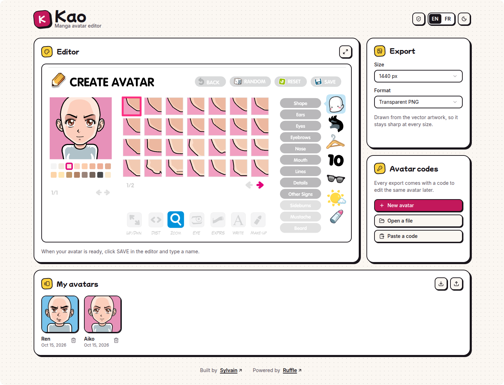
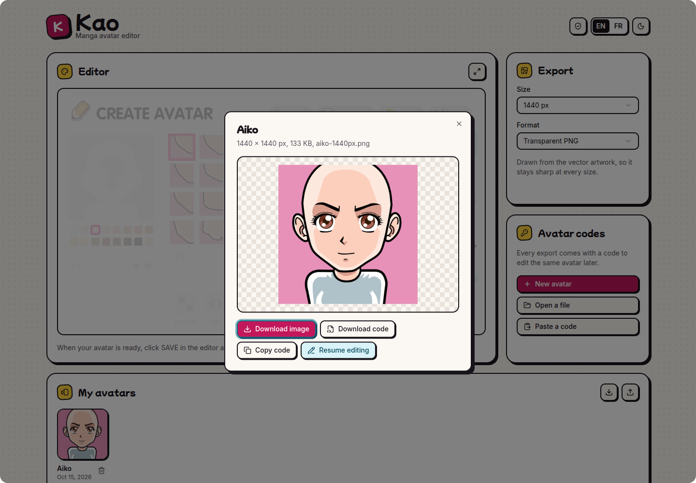

# Kao

A manga avatar editor in the browser, running on [Ruffle](https://ruffle.rs) with lossless
high-resolution export. Live at <https://kao.sylvain.sh>.

<picture>
  <source media="(prefers-color-scheme: dark)" srcset="docs/editor-dark.png">
  
</picture>

## Features

- A full editor with ~1,800 face parts, with menus in English or French.
- Export from 360 to 4320 px as transparent PNG, PNG on white, JPEG or WebP, drawn from the
  vector artwork: never upscaled, never blurry.
- A `.kao` code with every export, to reopen and keep editing the same avatar.
- _My avatars_: the exported avatars, kept in the browser's `localStorage`.
- Fully static and offline: nothing leaves the browser.

<picture>
  <source media="(prefers-color-scheme: dark)" srcset="docs/export-dark.png">
  
</picture>

## Usage

Download `kao-X.Y.Z.zip` from the [releases](../../releases), unzip it and run:

```sh
./start.sh            # opens Kao in a standalone browser window
./start.sh --install  # also adds Kao to the desktop applications menu
```

It needs Python 3 and a Chromium-based browser (Chrome, Chromium or Brave) on Linux. Everything runs
locally on port 7712 and nothing leaves your machine. You can also use it online at
<https://kao.sylvain.sh>.

Developers: see [CONTRIBUTING.md](CONTRIBUTING.md).

## License

The code written for Kao is released under the [BSD 3-Clause License](LICENSE). Ruffle, the editor
engine and the face parts keep their own terms.

## Credits

Powered by [Ruffle](https://ruffle.rs), distributed under the MIT and Apache-2.0 licenses
(`public/ruffle/`).
